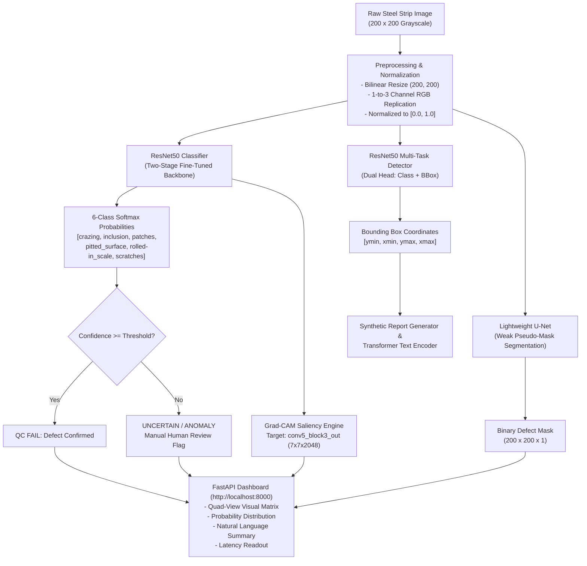
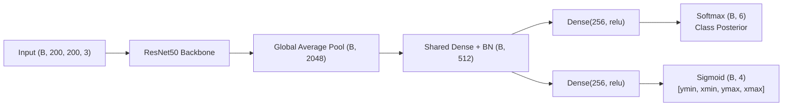

# System Architecture & Tensor Flow Specifications

## 1. End-to-End System Data Flow

---

## 2. Layer-Level Architecture & Tensor Shapes

### 2.1 Primary Defect Classifier (`ResNet50_DefectClassifier`)

| Layer / Sub-Block | Layer Type | Input Tensor Shape | Output Tensor Shape | Activation / Parameters | Function |
| :--- | :--- | :--- | :--- | :--- | :--- |
| `surface_image_input` | InputLayer | $(B, 200, 200, 3)$ | $(B, 200, 200, 3)$ | None | Batch input tensor |
| `rescaling` | Rescaling(255.0) | $(B, 200, 200, 3)$ | $(B, 200, 200, 3)$ | None | Map $[0, 1] \to [0, 255]$ |
| `resnet50_preprocess`| PreprocessInput | $(B, 200, 200, 3)$ | $(B, 200, 200, 3)$ | None | Zero-center ImageNet channels |
| `resnet50_backbone` | ResNet50 Base | $(B, 200, 200, 3)$ | $(B, 7, 7, 2048)$ | ReLU / Residual blocks | Deep hierarchical feature extraction |
| `avg_pool` | GlobalAvgPool2D | $(B, 7, 7, 2048)$ | $(B, 2048)$ | None | Spatial dimension collapse |
| `head_bn` | BatchNormalization | $(B, 2048)$ | $(B, 2048)$ | $\gamma, \beta$ (4,096 params) | Stabilize feature variance |
| `dense_features` | Dense | $(B, 2048)$ | $(B, 256)$ | ReLU (524,544 params) | Latent task-specific projection |
| `dropout` | Dropout(0.4) | $(B, 256)$ | $(B, 256)$ | Mask | Mitigate co-adaptation |
| `defect_probabilities`| Dense | $(B, 256)$ | $(B, 6)$ | Softmax (1,542 params) | 6-class normalized posterior |

> [!IMPORTANT]
> **BatchNormalization Freezing Policy**: During Stage 2 fine-tuning, top convolutional blocks (`conv5_block*`) are trained with learning rate $10^{-4}$, but **all `BatchNormalization` layers remain strictly frozen (`training=False`)**. This prevents mini-batch sample statistic estimation from destabilizing the well-calibrated ImageNet mean and variance under small domain batch sizes (16 or 32 on CPU).

---

### 2.2 Dual-Head Defect Object Detector (`ResNet50_DefectDetector`)

> [!NOTE]
> **Detector Selection & Fallback**: Keras-CV RetinaNet with a ResNet50 backbone was benchmarked on CPU (`models/retinanet_benchmark.py`). With a measured step latency of **46.79 seconds for batch size 2** (~491 minutes/epoch, ~82 hours for 10 epochs), RetinaNet exceeded the 30-minute training limit. The system fell back to the multi-task shared-backbone architecture below, achieving **200.07 ms latency (5.00 FPS)** on CPU and **24.07% mAP@0.5** (**86.67% AP@0.5** on pitted surfaces).

---

### 2.3 Lightweight U-Net Defect Segmentation Architecture

* **Input**: $(B, 200, 200, 1)$ grayscale steel surface.
* **Encoder**:
  - Level 1: $2 \times \text{Conv2D}(32, 3\times3, \text{same}) \to (B, 200, 200, 32)$; MaxPool $\to (B, 100, 100, 32)$ [Skip 1].
  - Level 2: $2 \times \text{Conv2D}(64, 3\times3, \text{same}) \to (B, 100, 100, 64)$; MaxPool $\to (B, 50, 50, 64)$ [Skip 2].
  - Level 3: $2 \times \text{Conv2D}(128, 3\times3, \text{same}) \to (B, 50, 50, 128)$; MaxPool $\to (B, 25, 25, 128)$ [Skip 3].
* **Bottleneck**:
  - $2 \times \text{Conv2D}(256, 3\times3, \text{same}) + \text{Dropout}(0.3) \to (B, 25, 25, 256)$.
* **Decoder**:
  - UpLevel 3: $\text{Conv2DTranspose}(128, 2\times2) \to (B, 50, 50, 128) + \text{Concat}(\text{Skip 3}) \to 2 \times \text{Conv2D}(128) \to (B, 50, 50, 128)$.
  - UpLevel 2: $\text{Conv2DTranspose}(64, 2\times2) \to (B, 100, 100, 64) + \text{Concat}(\text{Skip 2}) \to 2 \times \text{Conv2D}(64) \to (B, 100, 100, 64)$.
  - UpLevel 1: $\text{Conv2DTranspose}(32, 2\times2) \to (B, 200, 200, 32) + \text{Concat}(\text{Skip 1}) \to 2 \times \text{Conv2D}(32) \to (B, 200, 200, 32)$.
* **Output**: $\text{Conv2D}(1, 1\times1, \text{sigmoid}) \to (B, 200, 200, 1)$ pixel-wise defect likelihood.

---

### 2.4 Synthetic Report Transformer Encoder

* **Input**: Sequence of token IDs $\mathbf{x} \in \mathbb{Z}^{B \times 25}$.
* **Token & Position Embedding**:
  - Token Embedding: $\mathbf{E}_{\text{token}} \in \mathbb{R}^{B \times 25 \times 64}$.
  - Learned Positional Embedding: $\mathbf{E}_{\text{pos}} \in \mathbb{R}^{1 \times 25 \times 64}$.
  - Summed Embedding: $\mathbf{Z}_0 = \mathbf{E}_{\text{token}} + \mathbf{E}_{\text{pos}} \in \mathbb{R}^{B \times 25 \times 64}$.
* **Multi-Head Self-Attention Block**:
  - $h = 4$ attention heads, key dimension $d_k = 32$.
  - Scaled Dot-Product Attention:
    $$\text{Attention}(Q, K, V) = \text{softmax}\left(\frac{QK^T}{\sqrt{d_k}}\right)V$$
  - Residual connection: $\mathbf{Z}' = \text{LayerNorm}(\mathbf{Z}_0 + \text{Dropout}(\text{MHA}(\mathbf{Z}_0)))$.
  - Feed-Forward network: $\text{Dense}(128, \text{relu}) \to \text{Dense}(64)$.
  - Residual connection: $\mathbf{Z}_1 = \text{LayerNorm}(\mathbf{Z}' + \text{Dropout}(\text{FFN}(\mathbf{Z}')))$.
* **Classification Output Head**: GlobalAveragePooling1D $\to \text{Dense}(64, \text{relu}) \to \text{Dense}(6, \text{softmax})$.

---

### 2.5 Convolutional Variational Autoencoder (Conv-VAE)

* **Encoder**:
  $$\mathbf{x} \in \mathbb{R}^{B \times 64 \times 64 \times 1} \xrightarrow{\text{ConvBlocks}} \mathbf{h} \in \mathbb{R}^{B \times 8 \times 8 \times 128} \xrightarrow{\text{Dense}} \boldsymbol{\mu} \in \mathbb{R}^{B \times 32}, \, \log\boldsymbol{\sigma}^2 \in \mathbb{R}^{B \times 32}$$
* **Reparameterization Sampling**:
  $$\mathbf{z} = \boldsymbol{\mu} + \boldsymbol{\sigma} \odot \boldsymbol{\epsilon}, \quad \boldsymbol{\epsilon} \sim \mathcal{N}(\mathbf{0}, \mathbf{I})$$
* **Decoder**:
  $$\mathbf{z} \in \mathbb{R}^{B \times 32} \xrightarrow{\text{Dense}} (B, 8, 8, 128) \xrightarrow{\text{ConvTranspose}} \hat{\mathbf{x}} \in [0, 1]^{B \times 64 \times 64 \times 1}$$
* **Objective Function**:
  $$\mathcal{L}_{\text{VAE}} = \mathbb{E}_{q(\mathbf{z}|\mathbf{x})}[\log p(\mathbf{x}|\mathbf{z})] - D_{\text{KL}}(q(\mathbf{z}|\mathbf{x}) \parallel p(\mathbf{z}))$$
