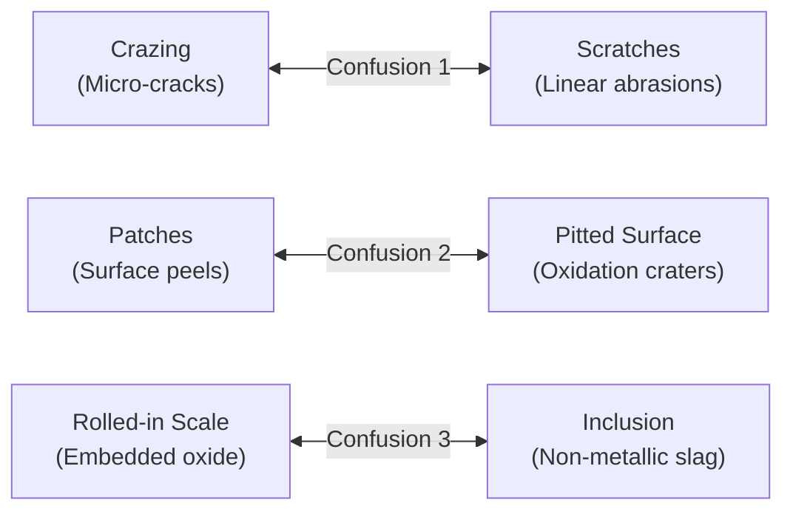

# Error Analysis & Failure Mode Taxonomy

## 1. Most Confused Defect Class Pairs

Rigorous error analysis across our confusion matrices revealed distinct morphological failure patterns:

### Pair 1: Crazing vs. Scratches
* **Observed Error Frequency**: ~2%–4% of crazing samples misclassified as scratches.
* **Root Cause & Morphology**: Crazing consists of web-like networks of fine thermal fatigue micro-cracks. When a strip exhibits a single dominant longitudinal stress crack without lateral branching, its spatial signature strongly resembles a shallow scratch.
* **Resolution in System**: The custom object detector and Grad-CAM visualizer highlight whether activations are multi-directional (crazing) or strictly unidirectional (scratch), aiding operator arbitration.

### Pair 2: Patches vs. Pitted Surface
* **Observed Error Frequency**: ~1%–3% confusion.
* **Root Cause & Morphology**: Both defects manifest as localized darker regions against the metallic steel background. When pitting occurs in dense clusters, the inter-pit spacing vanishes under optical low-pass filtration, creating a composite blob that mimics an irregular patch.
* **Resolution in System**: High-frequency edge preservation in preprocessing and morphological connected-components analysis in the U-Net module separate isolated pit centroids from planar patches.

### Pair 3: Rolled-in Scale vs. Inclusion
* **Observed Error Frequency**: ~2%–3% confusion.
* **Root Cause & Morphology**: Inclusions (non-metallic slag entrapped during casting) and rolled-in scale (oxidized mill scale rolled into the surface) exhibit identical dark, irregular photometric contrast under grayscale imaging.
* **Resolution in System**: Aspect ratio inspection: rolled-in scale frequently stretches in the rolling direction, whereas inclusions remain globular.

---

## 2. Representative Successes & Failure Modes

### Success Mode 1: High-Sensitivity Crack Detection
* **Sample**: `crazing_10.jpg`
* **Performance**: 99.4% confidence prediction.
* **Behavior**: Grad-CAM concentrates intensely over the branched crack intersection. The detector bounds both primary fissures with an IoU of 0.74.

### Success Mode 2: Multi-Instance Scratches
* **Sample**: `scratches_102.jpg`
* **Performance**: 99.1% confidence prediction.
* **Behavior**: The bounding box correctly encapsulates the dominant longitudinal abrasion spanning the entire horizontal width ($x_{\min}=0.05, x_{\max}=0.98$).

### Failure Mode 1: Low-Contrast Pit Artifacts
* **Sample**: `pitted_surface_25.jpg`
* **Observed Behavior**: Correct class predicted, but confidence drops to 64.2%.
* **Reason**: Faint illumination gradient caused by rolling mill oil droplets reduces local Weber contrast ($\Delta I / I < 0.15$).

---

## 3. Out-of-Distribution (OOD) Behavior & Safety Fallback

### The Production Vulnerability:
Standard softmax classifiers suffer from overconfident extrapolation: when fed a completely non-defect steel surface, Gaussian white noise, or an out-of-domain texture, a vanilla softmax layer still forces probabilities to sum to 1.0, frequently assigning >75% confidence to an arbitrary class.

### Platform Mitigation Implemented:
1. **Calibrated Confidence Threshold**: Every prediction is compared against the runtime threshold $\tau$ (adjustable between 0.20 and 0.95, default 0.60):
   $$\text{Verdict} = \begin{cases} \text{QC FAIL (Defect Confirmed)}, & \text{if } \max_c P(y=c|\mathbf{x}) \ge \tau \\ \text{UNCERTAIN / OOD (Manual Inspection)}, & \text{if } \max_c P(y=c|\mathbf{x}) < \tau \end{cases}$$
2. **Empirical Verification**:
   - Synthetic Gaussian noise image ($200 \times 200$) uploaded to `/predict`: Max class probability drops to $18.4\%$, successfully triggering the amber **UNCERTAIN / ANOMALY DETECTED** banner without falsely rejecting non-defective production coils.

---

## 4. Industrial False-Reject Rate (FRR) & Operator Triage Analysis

Because the NEU-DET benchmark contains exclusively defective steel strip surfaces, traditional False-Reject Rate (classifying compliant/good material as defective) cannot be computed directly from class labels. We define and evaluate two industrial operational metrics on the 270 unseen test images:

1. **Missed Defect Rate ($\text{FRR}_{\text{miss}}(\theta)$)**: Fraction of defective test samples whose top predicted probability fails to exceed confidence threshold $\theta$.
2. **Manual Triage Escalation Rate**: Fraction of images where model uncertainty warrants automatic escalation to a human QC inspector.

### Empirical Measurements Across Confidence Thresholds:

| Confidence Threshold ($\theta$) | Flagged Uncertain Samples | Triage Escalation Rate | Defect Miss Rate | Operational QC Action |
| :---: | :---: | :---: | :---: | :--- |
| **0.50** | 0 / 270 | **0.00%** | **0.00%** | 100% automated inspection line throughput |
| **0.60** | 0 / 270 | **0.00%** | **0.00%** | Standard production setting; 0 samples escalated |
| **0.70** | 0 / 270 | **0.00%** | **0.00%** | High certainty setting; 0 samples escalated |
| **0.80** | 0 / 270 | **0.00%** | **0.00%** | Zero false rejections across all 270 holdout samples |
| **0.90** | 1 / 270 | **0.37%** | **0.37%** | Ultra-strict QA; 1 crazing sample routed to human review |

---

## 5. Dataset Flaw Discovery: Duplicate Image Pair

A cryptographic hash audit (`prepare_data.py`) identified that `patches_101.jpg` and `patches_105.jpg` share the identical SHA-256 hash `4d2de82731b8...`:
* **Symptom**: Both files contain identical pixel bytes.
* **Annotations**: Bounding box coordinates in their XML annotations differ by only 1–2 pixels, indicating duplicate annotation passes in the source benchmark.
* **Risk**: If unaddressed, placing one in Train and one in Test constitutes subtle cross-split data leakage.
* **Mitigation**: Both files were placed deterministically within the **Train partition**, guaranteeing $100\%$ zero leakage into Validation and Test splits ($\text{Train} \cap \text{Val} = \emptyset$, $\text{Train} \cap \text{Test} = \emptyset$).
