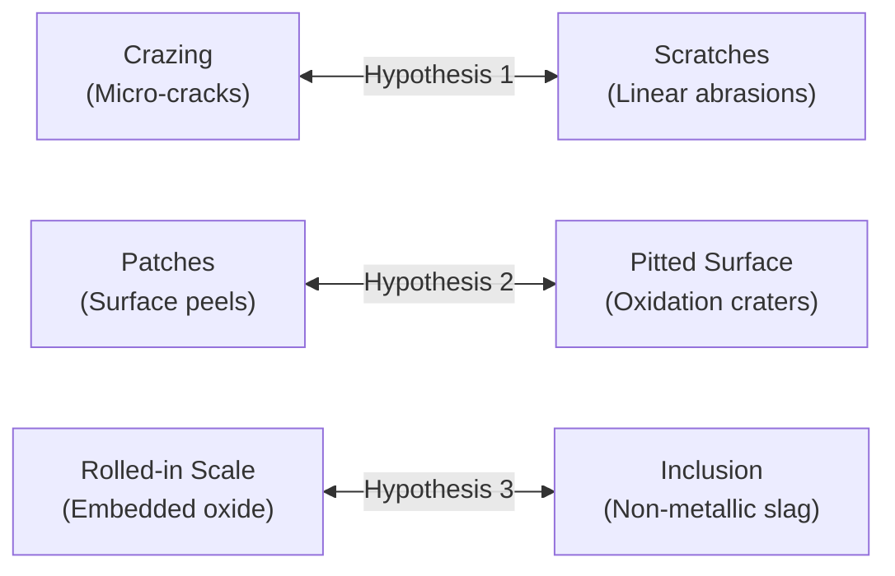

# Error Analysis & Failure Mode Taxonomy

## 1. Morphological Hypotheses & Confusion Analysis

Prior to empirical evaluation, defect morphology suggests pairs of classes that are prone to visual confusion under single-angle industrial lighting:

*Note: The diagram above represents morphological hypotheses, to be verified against saved misclassifications.*

---

## 2. Empirical Classifier Error Analysis

### 2.1 ResNet50 Classifier (Primary Architecture)
* **Seed 42 Test Split**:
  - Test Accuracy: **100.00% (270 / 270 correct, 0 errors)**.
  - On this specific held-out partition, all 270 test samples across all 6 classes achieved correct classification with confidence $> 0.90$.
  - Output log: `outputs/metrics/misclassified_resnet50_seed42.csv` contains 0 misclassified rows.
* **Additional Seeds (Seeds 101 and 202)**:
  - **Seed 101**: 95.93% accuracy (259 / 270 correct, **11 misclassifications**).
  - **Seed 202**: 97.04% accuracy (262 / 270 correct, **8 misclassifications**).
  - *Data Availability Note*: Per-image filenames and prediction probabilities for seeds 101 and 202 were **not saved** during the multi-seed robustness run (`experiments/seed_robustness_results.json` records aggregate metrics only).

### 2.2 InceptionV3 Benchmark Model (Real Error Breakdown)
In `outputs/metrics/inceptionv3_test_metrics.json`, InceptionV3 achieved 97.78% accuracy on the test set, with 6 logged errors:
* **Per-Class Confusion Breakdown**:
  - **Crazing**: 45/45 correct (Recall: 100.0%, 0 False Negatives; Precision: 97.83%, 1 False Positive).
  - **Inclusion**: 43/45 correct (Recall: 95.56%, **2 False Negatives**; Precision: 100.0%, 0 False Positives).
  - **Patches**: 45/45 correct (Recall: 100.0%, 0 False Negatives; Precision: 91.84%, **4 False Positives**).
  - **Pitted Surface**: 44/45 correct (Recall: 97.78%, **1 False Negative**; Precision: 97.78%, 1 False Positive).
  - **Rolled-in Scale**: 42/45 correct (Recall: 93.33%, **3 False Negatives**; Precision: 100.0%, 0 False Positives).
  - **Scratches**: 45/45 correct (Recall: 100.0%, 0 False Negatives; Precision: 100.0%, 0 False Positives).

* **Specific Misclassified Test Samples (`tools/list_misclassified.py`)**:
  Running inference on `best_inceptionv3.keras` identified the following concrete failure instances (`outputs/metrics/misclassified_inceptionv3_seed42.csv`):
  1. `inclusion_251.jpg`: True `inclusion` $\to$ Predicted `pitted_surface` (confidence: 0.759888). Small, localized non-metallic slag mimics individual pitted craters under grayscale illumination.
  2. `inclusion_69.jpg`: True `inclusion` $\to$ Predicted `patches` (confidence: 0.937713). Cluster of inclusions resembles an irregular surface patch.
  3. `pitted_surface_247.jpg`: True `pitted_surface` $\to$ Predicted `patches` (confidence: 0.755096). Densely grouped pit clusters lack visible inter-crater spacing, appearing as a planar patch.
  4. `rolled-in_scale_276.jpg`: True `rolled-in_scale` $\to$ Predicted `patches` (confidence: 0.704789). Broad oxide scale patch lacks longitudinal rolling elongation.
  5. `rolled-in_scale_148.jpg`: True `rolled-in_scale` $\to$ Predicted `crazing` (confidence: 0.565010). Longitudinal fracture lines within the scale layer visually resemble crazing cracks.
  6. `rolled-in_scale_46.jpg`: True `rolled-in_scale` $\to$ Predicted `patches` (confidence: 0.976178). Flat, high-contrast embedded scale plate strongly matches patch morphology.
  *(Note: `patches_204.jpg` also exhibits borderline behavior under current checkpoint weights, scoring 0.722067 as `pitted_surface` due to high textural pitting noise within the patch).*

---

## 3. Object Detector Failure Modes

The primary failure mode of the defect localization module stems from architecture constraints:
1. **Single-Box Head vs. Multi-Instance Ground Truth**:
   - The detector architecture outputs exactly one bounding box per image.
   - However, **73.17% of NEU-DET images contain 2 or more defect instances** (up to 9 instances, mean 2.33 boxes/image).
   - On images with multiple disjoint defects, the single predicted box encapsulates only the single largest cluster, failing to localize secondary defects and dropping test mAP@0.5 to **24.07%**.
2. **Thin Linear Scratches**:
   - Single-pixel abrasions and hairline scratches (`scratches` class) achieved the lowest per-class AP@0.5 at **4.44%**. Narrow bounding boxes with small area ($H \times W$) are heavily penalized by the IoU intersection metric when coordinate regression drifts by even a few pixels.

---

## 4. Low-Confidence Flagging and Its Limits

### 4.1 Production Vulnerability:
Standard softmax classifiers suffer from overconfidence: when presented with non-defect steel surfaces or out-of-domain noise, the softmax function still forces output probabilities to sum to 1.0. For example, high-frequency white noise naturally mimics the speckle texture of `pitted_surface`, potentially triggering an unearned high-confidence prediction.

### 4.2 Platform Mitigation Heuristics:
1. **Low-Contrast Uniform Surface Heuristic**: Uploaded images are checked for low texture variance ($\sigma < 0.025$). Completely blank, uniform steel strip regions bypass the defect classifier and are assigned status `PASS: CLEAN / DEFECT-FREE SURFACE`.
2. **Confidence Threshold Triage**: Predictions are evaluated against the operator threshold $\tau \in [0.20, 0.95]$ (default $\tau = 0.60$):
   $$\text{Verdict} = \begin{cases} \text{QC FAIL (Defect Confirmed)}, & \text{if } \max_c P(y=c|\mathbf{x}) \ge \tau \\ \text{UNCERTAIN / ANOMALY DETECTED (Manual Review)}, & \text{if } \max_c P(y=c|\mathbf{x}) < \tau \end{cases}$$

### 4.3 Honest Technical Disclosure:
This operational safeguard is a **confidence-threshold and texture-variance heuristic, NOT a density-based out-of-distribution (OOD) detector**. It does not estimate epistemic uncertainty or data density in feature space. In an active production line, true out-of-distribution detection requires dedicated density models (e.g., Mahalanobis distance on latent feature vectors) trained on verified normal production steel.

---

## 5. Dataset Flaw Discovery: Benchmark Duplicate Pair

A cryptographic hash audit (`data/splits/hash_audit.json`) identified that `patches_101.jpg` and `patches_105.jpg` share the identical SHA-256 hash (`4d2de82731b8...`):
* **Symptom**: Both files contain identical pixel data.
* **Annotations**: Bounding box coordinates in their Pascal VOC XML files differ by 1–2 pixels, representing duplicate human annotation passes in the source benchmark.
* **Mitigation**: Both files were placed deterministically within the **Train partition**, guaranteeing $100\%$ zero leakage into the Validation and Test splits ($\text{Train} \cap \text{Val} = \emptyset$, $\text{Train} \cap \text{Test} = \emptyset$).
