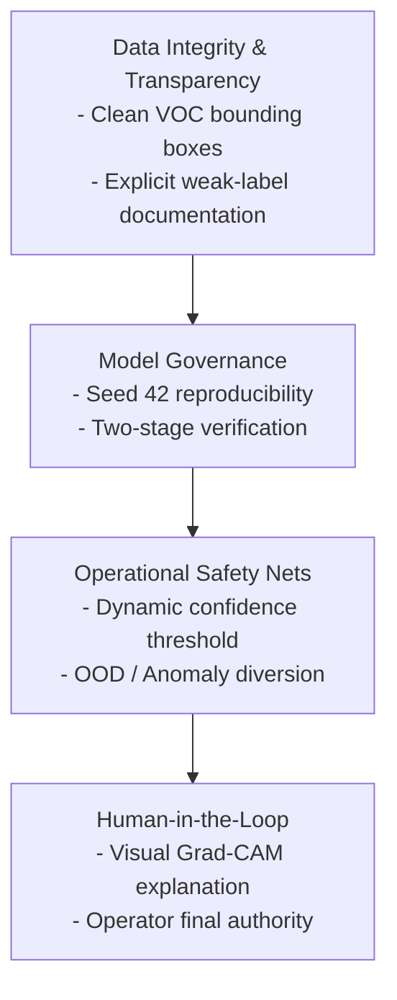

# Responsible AI, Safety, and Governance Guidelines

## 1. Principles in Industrial Autonomous Systems

Deploying artificial intelligence in manufacturing quality assurance introduces distinct ethical, operational, and safety obligations:

---

## 2. Core Pillars of the Platform

### 2.1 Transparency & Explainability
* **The Black-Box Risk**: Deep neural networks cannot be trusted blindly in manufacturing environments where a single missed crack can compromise structural steel integrity in bridges or automotive bodies.
* **Implemented Solution**: Grad-CAM visual heatmaps are displayed synchronously with every classification decision. Operators can immediately verify that the model is responding to real physical micro-cracks or pit craters rather than superficial dust or lens scratches.

### 2.2 Truthful Representation of Weak Labels
* **The Caveat**: NEU-DET contains bounding box coordinates, **not** ground-truth human semantic segmentation masks.
* **Governance**: The platform explicitly labels all segmentation masks as *weak pseudo-labels* derived from bounding boxes and Otsu thresholding. Evaluated Dice and IoU metrics are reported with this clear caveat to prevent misleading operators into assuming sub-pixel annotation fidelity.

### 2.3 Fail-Safe Human-in-the-Loop (HITL) Fallback
* **Low-Confidence Safeguard**: Autonomous systems must know when they do not know.
* **Mechanism**: Whenever the highest softmax probability falls below the operator's configured threshold (e.g. 60%), the platform refuses to emit an autonomous rejection and flags the sample as **UNCERTAIN / ANOMALY**. The steel coil is routed to the manual visual station, guaranteeing human oversight on ambiguous materials.

### 2.4 Environmental & Energy Efficiency
* **Edge & CPU Optimization**: The model family is designed with lightweight backbones (ResNet50, InceptionV3, U-Net) optimized to execute directly on standard industrial PC processors without requiring power-hungry server racks or high-wattage GPUs, minimizing the manufacturing line's computational carbon footprint.
